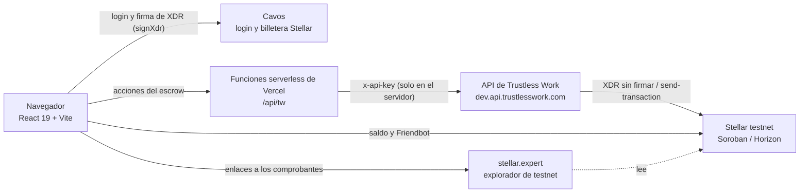
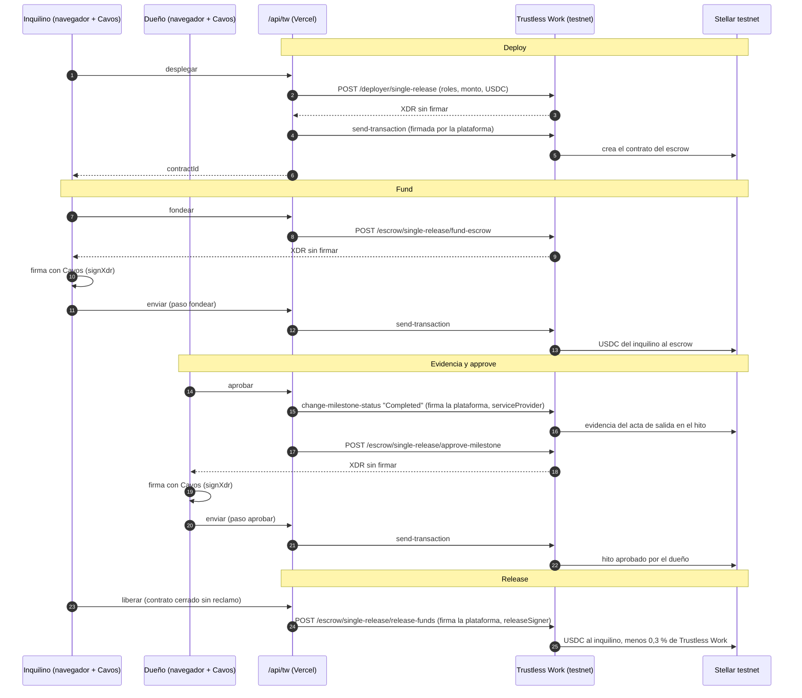

# Lockumi

## Video demo

<!-- VIDEO_ADJUNTO -->

[](docs/demo/lockumi-demo.mp4)

1:14, con voz narrada. [Ver el video en GitHub](https://github.com/businessapplockumi-crypto/lockumi-app/blob/master/docs/demo/lockumi-demo.mp4) · [Descargar el MP4](https://github.com/businessapplockumi-crypto/lockumi-app/raw/master/docs/demo/lockumi-demo.mp4)

Lockumi es una app de **depósito de alquiler protegido** para Costa Rica. Dueño e inquilino firman el contrato, documentan el estado del inmueble con fotos al entrar y al salir, y el depósito de garantía queda protegido en un escrow hasta el final del alquiler.

- App: https://app.lockumi.com
- Sitio: https://lockumi.com

> **Red de prueba.** Todo lo que toca Stellar ocurre en **testnet**, con USDC de prueba de Circle que **no tiene valor**. La red principal está bloqueada en el código del servidor.

## Contenido

- [Prueba el flujo en 5 minutos (guía para jueces)](#prueba-el-flujo-en-5-minutos-guía-para-jueces)
- [El problema](#el-problema) · [Cómo funciona](#cómo-funciona)
- [Arquitectura](#arquitectura)
- [Roles del escrow](#roles-del-escrow)
- [Contratos e IDs en testnet](#contratos-e-ids-en-testnet)
- [Privacidad en la cadena](#privacidad-en-la-cadena)
- [Qué es real y qué es simulado](#qué-es-real-y-qué-es-simulado)
- [Cómo correrlo localmente](#cómo-correrlo-localmente)
- [Stack](#stack) · [Enlaces](#enlaces) · [Equipo](#equipo) · [Contribuir](#contribuir) · [Licencia](#licencia)

## Prueba el flujo en 5 minutos (guía para jueces)

Esta guía describe la versión con flujo real en testnet. Antes de empezar:

- **Es la red de prueba de Stellar (testnet).** Los USDC y XLM que vas a usar son tokens de prueba **sin valor**.
- **En esta versión el servidor firma con cuentas de prueba rotuladas** ("dueño de prueba" e "inquilino de prueba"), para que una sola persona pueda recorrer todo el flujo. Sus llaves viven solo en el servidor; el navegador nunca las recibe.
- **El mediador es simulado.** En el camino feliz no hace falta: no hay reclamo.
- Tope de **20 USDC** por contrato de prueba.

Pasos en https://app.lockumi.com:

1. **Entrar.** Elige "Continuar con Google", "Continuar con Apple" o "Continuar con tu correo" (Cavos). No necesitas instalar una billetera ni guardar frases semilla. <!-- AJUSTAR_UI -->
2. **Aceptar los términos.** Marca "Acepto los Términos y condiciones" (y el consentimiento de privacidad, si aparece) y toca "Entrar". Son textos de demo, pendientes de revisión por abogado. <!-- AJUSTAR_UI -->
3. **Crear el alquiler.** Completa inmueble, monto (hasta 20 USDC), fechas y reglas, y toca "Crear alquiler e invitar". <!-- AJUSTAR_UI -->
4. **Obtener USDC de prueba.** Toca "Obtener USDC de prueba". La app prepara la cuenta de testnet y le carga USDC de prueba de Circle (sin valor). <!-- AJUSTAR_UI -->
5. **Depositar en el escrow.** Toca "Depositar". El servidor crea el escrow *single-release* en Trustless Work y el inquilino deposita los USDC en ese contrato. <!-- AJUSTAR_UI -->
6. **El dueño de prueba aprueba.** Al terminar el alquiler, toca "Todo está bien: aprobar la devolución". La plataforma deja la evidencia en el hito y el dueño de prueba aprueba en la cadena. <!-- AJUSTAR_UI -->
7. **Liberar.** Toca "Liberar el depósito". La plataforma (releaseSigner) libera los fondos al inquilino; Trustless Work descuenta su comisión de 0,3 %. <!-- AJUSTAR_UI -->
8. **Abrir cada comprobante en stellar.expert.** Cada paso muestra "Ver comprobante en la red de prueba", que abre la transacción en `stellar.expert/explorer/testnet`. Ahí se ve el contrato del escrow, el depósito y la liberación. <!-- AJUSTAR_UI -->

¿No quieres crear nada? Abajo están las transacciones de una corrida real del mismo camino feliz: [Contratos e IDs en testnet](#contratos-e-ids-en-testnet).

## El problema

En muchos alquileres el depósito de garantía queda retenido al terminar el contrato sin pruebas de daños: no hay un acta clara del estado del inmueble al entrar ni al salir, y el inquilino no tiene cómo reclamar.

## Cómo funciona

1. **Contrato:** el dueño crea el alquiler (inmueble, monto, fechas y reglas), invita al inquilino y ambos firman.
2. **Depósito protegido:** el inquilino deposita; nadie puede liberar el dinero por su cuenta.
3. **Fotos de entrada:** se hace el acta de entrada con inventario y fotos con fecha y hora.
4. **Fotos de salida:** al terminar se hace el acta de salida.
5. **7 días para reclamos:** el dueño tiene 7 días para abrir un reclamo con pruebas.
6. **Devolución automática:** si no hay reclamo en ese plazo, el depósito vuelve al inquilino.
7. **Mediador:** si el inquilino no acepta el reclamo, el caso pasa a una persona mediadora que decide el reparto (en la demo, la mediación es simulada).

## Arquitectura



- La llave de Trustless Work (`TRUSTLESS_WORK_API_KEY`) y la clave de la cuenta de la plataforma solo existen en el servidor. Un build del cliente no las contiene.
- Trustless Work arma cada transacción y devuelve la XDR sin firmar. La firma quien tiene el rol (la plataforma en el servidor, o la billetera de Cavos del participante) y se envía con `POST /helper/send-transaction`.
- El proxy solo trabaja con la API de testnet y solo permite cinco acciones: `desplegar`, `fondear`, `aprobar`, `enviar` y `liberar` (`api/_lib/tw.ts`).

Flujo del camino feliz (sin reclamo):



En la versión con flujo real para una sola persona, el dueño de prueba es una cuenta que custodia el servidor, y firma ahí en lugar de en Cavos (ver la guía de arriba).

## Roles del escrow

Escrow *single-release* de Trustless Work (API REST v1). Asignación según `api/_lib/tw.ts` (rama `testnet-e2e`):

| Rol de Trustless Work | Quién lo tiene | Para qué |
|---|---|---|
| `approver` | Dueño | Aprueba la devolución ("entrega sin daños") o abre un reclamo (disputa). |
| `serviceProvider` | Plataforma Lockumi | Deja la evidencia del acta de salida (cambia el hito a "Completed"). |
| `platformAddress` | Plataforma Lockumi | Cuenta de la plataforma; comisión de plataforma 0 (`platformFee: 0`). |
| `releaseSigner` | Plataforma Lockumi | Libera el depósito desde el servidor después del plazo. |
| `disputeResolver` | Plataforma Lockumi (mediación) | Reparte el saldo en un reclamo. Por defecto es la plataforma; se puede cambiar con `LOCKUMI_TW_MEDIADOR_PUBLICA`. |
| `receiver` | Inquilino | El depósito vuelve a su cuenta. |

El depósito (`fund-escrow`) lo firma el inquilino. El proxy exige que las cuentas del dueño, del inquilino y de la plataforma sean distintas.

## Contratos e IDs en testnet

Verificados en Horizon testnet (`horizon-testnet.stellar.org`) y Soroban RPC de testnet el 18/10/2026.

| Qué | ID | Explorador |
|---|---|---|
| Emisor de USDC de prueba (Circle, `home_domain` centre.io) | `GBBD47IF6LWK7P7MDEVSCWR7DPUWV3NY3DTQEVFL4NAT4AQH3ZLLFLA5` | [cuenta](https://stellar.expert/explorer/testnet/account/GBBD47IF6LWK7P7MDEVSCWR7DPUWV3NY3DTQEVFL4NAT4AQH3ZLLFLA5) |
| Contrato del token USDC de prueba (SAC) | `CBIELTK6YBZJU5UP2WWQEUCYKLPU6AUNZ2BQ4WWFEIE3USCIHMXQDAMA` | [contrato](https://stellar.expert/explorer/testnet/contract/CBIELTK6YBZJU5UP2WWQEUCYKLPU6AUNZ2BQ4WWFEIE3USCIHMXQDAMA) |
| Cuenta de la plataforma (con trustline de USDC) | `GCTLNUBVQF2X26II7UFZMPPWOISX325DABCZU6ZJ3NJC3A3FA2U5TJ4G` | [cuenta](https://stellar.expert/explorer/testnet/account/GCTLNUBVQF2X26II7UFZMPPWOISX325DABCZU6ZJ3NJC3A3FA2U5TJ4G) |
| Escrow de la prueba (single-release) | `CCUVP4XKQCWCQTBUHZGA3PZAIYUGGKE2TNH4CZIXXGEMW6GOQY4RGCUS` | [contrato](https://stellar.expert/explorer/testnet/contract/CCUVP4XKQCWCQTBUHZGA3PZAIYUGGKE2TNH4CZIXXGEMW6GOQY4RGCUS) |
| Depósito de 2 USDC al escrow | `51db520b8df6b1f287f4545fc5b62d62b847b222d85dfab54300151c834da059` | [transacción](https://stellar.expert/explorer/testnet/tx/51db520b8df6b1f287f4545fc5b62d62b847b222d85dfab54300151c834da059) |
| Liberación: 1,994 USDC al inquilino y 0,006 USDC de comisión | `49fb34d0b510cd0a7b62ca5f9a66a82297ff0a240a1563498934c0b3ff51635c` | [transacción](https://stellar.expert/explorer/testnet/tx/49fb34d0b510cd0a7b62ca5f9a66a82297ff0a240a1563498934c0b3ff51635c) |

### Prueba real: 2 USDC depositados, 1,994 USDC devueltos

Corrida completa del camino feliz con `node scripts/e2e-testnet-tw.mjs` (rama `testnet-e2e`) el 16/10/2026 a las 11:56 p. m. (hora de Costa Rica), contra la API real de testnet de Trustless Work y con cuentas desechables: dueño `GD57OCAF…UIEX` e inquilino `GBMFMIUF…AQBY` (Cavos), plataforma `GCTLNUBV…TJ4G`.

| # | Paso | Transacción |
|---|---|---|
| 1 | Trustline USDC del dueño (Cavos `addTrustline`) | [1bfd4257…1bae](https://stellar.expert/explorer/testnet/tx/1bfd4257920d16ee0d916145c93fa240af28ce11ad6e06f883ef7a30671d1bae) |
| 2 | Trustline USDC del inquilino (Cavos `addTrustline`) | [3f400bb2…7563](https://stellar.expert/explorer/testnet/tx/3f400bb241ae437435f38f3c47b25233eb5d63cdd0f4e354a800d69290517563) |
| 3 | 2 USDC para el inquilino (DEX de testnet, XLM → USDC de Circle) | [314a636d…ddef](https://stellar.expert/explorer/testnet/tx/314a636d180599c4b41cfe15fb15a7f949b8f89d7da566cb61d08f3c9876ddef) |
| 4 | Deploy del escrow single-release (plataforma) | [74bf9594…3228](https://stellar.expert/explorer/testnet/tx/74bf9594875ff40349c8cf1ec69258d6c6bb2a5299cf25ff186e23c786a93228) |
| 5 | Depósito de 2 USDC (inquilino, Cavos `signXdr`) | [51db520b…a059](https://stellar.expert/explorer/testnet/tx/51db520b8df6b1f287f4545fc5b62d62b847b222d85dfab54300151c834da059) |
| 6 | Evidencia: hito "Completed" (plataforma) | [4a212fea…c766](https://stellar.expert/explorer/testnet/tx/4a212fea4861cd67da31ffd887cc392fb418c0af755fb82273a1f0957aa9c766) |
| 7 | Aprobación del dueño (Cavos `signXdr`) | [d98d3d39…9c9d](https://stellar.expert/explorer/testnet/tx/d98d3d3979faae4079023d7f2fad6801bf71d8c10be40f372ee3d5830ca09c9d) |
| 8 | Liberación (plataforma): 1,994 USDC al inquilino y 0,006 a `GA6KH5VW…CK7G` | [49fb34d0…635c](https://stellar.expert/explorer/testnet/tx/49fb34d0b510cd0a7b62ca5f9a66a82297ff0a240a1563498934c0b3ff51635c) |

Trustless Work cobra 0,3 % también en testnet, aunque `platformFee` sea 0: el inquilino recibe el 99,7 %. Detalle completo en `docs/testnet-e2e.md` (rama `testnet-e2e`).

## Privacidad en la cadena

Todo lo que se escribe en un escrow queda público y permanente en Stellar. Por eso:

- **Título fijo:** el escrow lleva un texto genérico fijo ("Depósito de alquiler Lockumi") y el id opaco del contrato como `engagementId` (en la versión con flujo real).
- **Sin datos personales:** nunca se envían a la cadena la dirección del inmueble, nombres, correos ni teléfonos; una última verificación en el servidor bloquea el deploy si algún texto los trae (en la versión con flujo real). Las fotos y las actas no van a la cadena; la evidencia del hito es un texto fijo (en la versión con flujo real).
- **Red principal bloqueada:** el proxy rechaza cualquier API de Trustless Work que no sea la de testnet (`dev.api.trustlesswork.com`) y lee y firma las transacciones solo con el passphrase de testnet (rama `testnet-e2e`). En la versión con flujo real, además, rechaza cualquier passphrase, Horizon o RPC que no sea de testnet.
- **Tope de 20 USDC** por contrato de prueba, en el cliente y en el servidor (en la versión con flujo real).

En `master`, app.lockumi.com no escribe nada en la cadena: el depósito es simulado.

## Qué es real y qué es simulado

| Parte | En `master` | En la versión con flujo real |
|---|---|---|
| Login | Real con Cavos si `VITE_CAVOS_APP_ID` está definido; si no, simulado (sin red; sirve cualquier código de 6 dígitos). | Real con Cavos. |
| Billetera | Billetera Stellar de testnet creada por Cavos; activación con Friendbot y saldo leído en Horizon testnet. | Igual, más la trustline de USDC de prueba. |
| Escrow | Simulado (`src/services/escrow.ts`); en pantalla se marca como "Pago simulado". | Real en testnet: Trustless Work single-release con USDC de prueba. |
| Firmas del dueño e inquilino | No hay firmas en la cadena. | El servidor firma con cuentas de prueba rotuladas (dueño e inquilino de prueba). En la rama `testnet-e2e` firman las billeteras de Cavos (`signXdr`). |
| Mediación | Simulada, sin efecto legal. | Simulada, sin efecto legal. |
| Plazo de reclamos | 7 días, con un botón de demo para adelantarlos. | Configurable para la prueba con `VITE_VENTANA_SEGUNDOS` (rama `testnet-e2e`). |
| Rendimiento con Blend (40/40/20) | Simulado (`src/services/yield.ts`). Es una **función futura, no disponible**: el reparto sería 40 % inquilino, 40 % dueño y 20 % Lockumi, con rendimiento variable y no garantizado. | Igual. |
| Datos | En el navegador (localStorage). | El servidor compartido con Supabase está en la rama `testnet-e2e`. |
| Textos legales | `/terminos` y `/privacidad`, versión de demo, pendientes de revisión por abogado. | Igual. |

### Login sin billetera con Cavos

`@cavos/kit` 0.4.2 (`src/services/auth.ts`, `src/services/billetera.ts`). La persona entra sin instalar una billetera ni guardar frases semilla, y Cavos crea una **billetera Stellar de testnet**. Métodos de acceso en el código:

- Google (redirección OAuth);
- Apple (redirección OAuth);
- correo electrónico con código de un solo uso (9 caracteres).

## Cómo correrlo localmente

Usa Node.js 22 (Vitest 5 pide `^22.12.0`; es la versión del CI).

```bash
npm ci
cp .env.example .env
npm run dev
npm test
```

Otros comandos: `npm run build`, `npm run lint`, `npm run preview`.

Variables de entorno (ver `.env.example`; **nunca subas `.env`**, está en `.gitignore`):

| Variable | Dónde | Qué hace |
|---|---|---|
| `VITE_CAVOS_APP_ID` | Cliente | App ID público de Cavos. Sin esta variable la app usa el acceso simulado. |
| `VITE_SUPABASE_URL` | Cliente | URL del proyecto de Supabase (servidor compartido). Sin las variables `VITE_SUPABASE_*` la app guarda los datos en el navegador. *(rama `testnet-e2e`)* |
| `VITE_SUPABASE_ANON_KEY` | Cliente | Clave pública (publishable/anon) de Supabase. *(rama `testnet-e2e`)* |
| `VITE_TRUSTLESS` | Cliente | `1` activa el escrow real de Trustless Work por `/api/tw`. *(rama `testnet-e2e`)* |
| `VITE_VENTANA_SEGUNDOS` | Cliente | Plazo de reclamos para la prueba, en segundos (mínimo 60; por defecto 7 días). *(rama `testnet-e2e`)* |
| `TRUSTLESS_WORK_API_KEY` | Servidor | Llave de la API de testnet de Trustless Work. Nunca con prefijo `VITE_`. *(rama `testnet-e2e`)* |
| `LOCKUMI_TW_PLATAFORMA_SECRET` | Servidor | Clave secreta de la cuenta de la plataforma (platformAddress, serviceProvider, releaseSigner y disputeResolver). *(rama `testnet-e2e`)* |
| `LOCKUMI_TW_MEDIADOR_PUBLICA` | Servidor | Opcional: otra cuenta G… como disputeResolver (por defecto, la plataforma). *(rama `testnet-e2e`)* |
| `TRUSTLESS_WORK_BASE_URL` | Servidor | Opcional: URL de la API de Trustless Work; solo se acepta la de testnet. *(rama `testnet-e2e`)* |
| `TRUSTLESS_WORK_TRUSTLINE` | Servidor | Opcional: emisor del activo del escrow (por defecto, el emisor de USDC de prueba). *(rama `testnet-e2e`)* |
| `SUPABASE_URL` | Servidor | URL del proyecto de Supabase para el proxy. *(rama `testnet-e2e`)* |
| `SUPABASE_ANON_KEY` | Servidor | Clave anon de Supabase, para validar la sesión del usuario. *(rama `testnet-e2e`)* |
| `SUPABASE_SERVICE_ROLE_KEY` | Servidor | Clave de servicio de Supabase (lectura y registro de eventos desde el proxy). *(rama `testnet-e2e`)* |

En `master` solo se usa `VITE_CAVOS_APP_ID`.

## Stack

- React 19 + TypeScript 6 + Vite 8 (`@vitejs/plugin-react`)
- `@cavos/kit` 0.4.2 (login y billetera Stellar) y `@stellar/stellar-sdk` 16.3.1
- Vitest 5 (pruebas), Oxlint (lint), Playwright (pruebas en el navegador)
- Despliegue en Vercel (funciones serverless en `api/`)
- Trustless Work (API REST v1 de testnet), Stellar testnet (Soroban y Horizon), USDC de prueba de Circle y Supabase (ramas `testnet-e2e` y flujo real)

## Enlaces

- App: https://app.lockumi.com
- Sitio: https://lockumi.com
- Trustless Work: https://www.trustlesswork.com
- Explorador de testnet: https://stellar.expert/explorer/testnet

## Equipo

- Katherine Moreira Solano

## Contribuir

Lee [CONTRIBUTING.md](CONTRIBUTING.md).

## Licencia

[MIT](LICENSE) © 2026 Katherine María Moreira Solano
