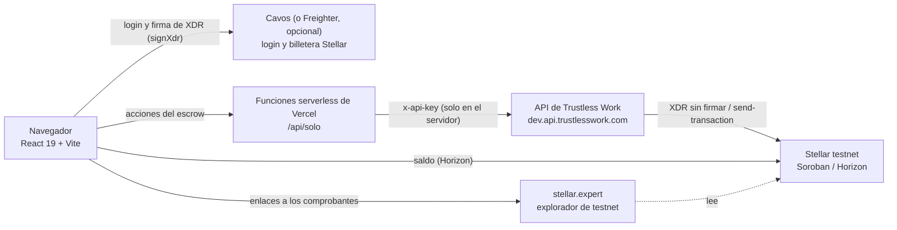
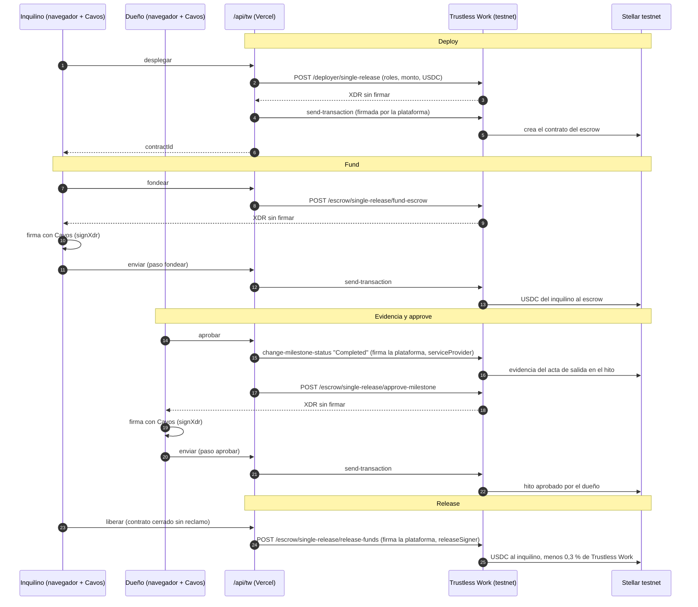

# Lockumi

## Video demo

<!-- VIDEO_ADJUNTO -->

[](docs/demo/lockumi-demo.mp4)

1:14, con voz narrada. [Ver el video en GitHub](https://github.com/businessapplockumi-crypto/lockumi-app/blob/master/docs/demo/lockumi-demo.mp4) · [Descargar el MP4](https://github.com/businessapplockumi-crypto/lockumi-app/raw/master/docs/demo/lockumi-demo.mp4)

Lockumi es una app de **depósito de alquiler protegido** para Costa Rica. Dueño e inquilino firman el contrato, documentan el estado del inmueble con fotos al entrar y al salir, y el depósito de garantía queda protegido en un escrow hasta el final del alquiler.

- App: https://app.lockumi.com
- Sitio: https://lockumi.com

> **Red de prueba.** Todo lo que toca Stellar ocurre en **testnet**, con USDC de prueba de Circle que **no tiene valor**. No hay dinero real. La red principal está bloqueada en el código del cliente y del servidor.

## Contenido

- [Prueba el flujo en 5 minutos (guía para jueces)](#prueba-el-flujo-en-5-minutos-guía-para-jueces)
- [El problema](#el-problema) · [Cómo funciona](#cómo-funciona)
- [Arquitectura](#arquitectura)
- [Roles del escrow](#roles-del-escrow)
- [Contratos e IDs en testnet](#contratos-e-ids-en-testnet)
- [Privacidad en la cadena](#privacidad-en-la-cadena)
- [Qué es real y qué es simulado](#qué-es-real-y-qué-es-simulado)
- [Correo con Resend (próximamente)](#correo-con-resend-próximamente)
- [Cambios publicados](#cambios-publicados)
- [Cómo correrlo localmente](#cómo-correrlo-localmente)
- [Stack](#stack) · [Enlaces](#enlaces) · [Equipo](#equipo) · [Contribuir](#contribuir) · [Licencia](#licencia)

## Prueba el flujo en 5 minutos (guía para jueces)

Esta guía describe lo que hace hoy https://app.lockumi.com (código de `master`). Antes de empezar:

- **Es la red de prueba de Stellar (testnet).** Los USDC y XLM que vas a usar son tokens de prueba **sin valor**. No hay dinero real ni red principal (mainnet).
- **Lo recorre una sola persona.** Tú eres el **inquilino**. El dueño es un **dueño de prueba**, rotulado en pantalla como "cuenta de Lockumi para la demo": firma y confirma solo, unos segundos después de ti. Sus llaves viven solo en el servidor; el navegador nunca las recibe.
- **En cada pantalla aparece una línea "Ahora te toca…"** (o "Ahora le toca al dueño de prueba…") que dice qué sigue y quién lo hace.
- **La persona mediadora es simulada**: decides tú el reparto, pero la transacción del reparto sí es real en testnet.
- **Cada paso mueve el escrow de verdad** en Trustless Work (testnet) con USDC de prueba de Circle, y muestra "Ver comprobante en la red de prueba" (stellar.expert).

Pasos en https://app.lockumi.com:

1. **Entrar sin billetera.** Toca "Entrar", marca "Acepto los Términos y condiciones" (y el consentimiento de privacidad, si aparece) y elige "Continuar con Google", "Continuar con Apple" o "Continuar con tu correo" (Cavos). No necesitas instalar una billetera ni guardar frases semilla. Freighter es opcional: solo sirve si quieres depositar USDC de prueba desde tu propia cuenta. Los textos legales vigentes son los **Términos y el Aviso de privacidad 1.5-demo (20 de octubre de 2026)**; son de demo y están pendientes de revisión por abogado. Si aceptaste una versión anterior, las casillas vuelven a salir sin marcar.
2. **Contrato y reglas.** Toca "+ Nuevo alquiler" (pantalla «Nuevo alquiler») y completa:
   - **Lugar.** Se queda en tu navegador; a la red solo va una huella de las fotos.
   - **USDC de prueba.** Elige de dónde salen:
     - **«USDC de prueba de Lockumi»** (opción por defecto): USDC de prueba que te da Lockumi, sin valor, **hasta 20**. Quedan en una cuenta de inquilino de prueba de Lockumi, no en tu billetera.
     - **«Usar mi propio USDC de prueba»**: depositas USDC de prueba que ya tienes, con tu billetera de Lockumi (Cavos) o con Freighter. El formulario muestra tu saldo real (leído en Horizon testnet); el límite es ese saldo, con un máximo de **50 000 USDC de prueba**.
   - **Depósito.** Botones − y + (de 1 en 1) o escribe el monto; no pasa el tope de la opción elegida.
   - **Fechas.** Dos tarjetas, **Entrada** y **Salida**, una al lado de la otra (también en celular, con la etiqueta arriba y la fecha abajo). Cada una abre un calendario: en celular, como hoja desde abajo; en escritorio, como ventanita junto a la tarjeta. Formato dd/mm/aa. La entrada va de hoy a 1 año; la duración, de 1 mes a 5 años; los días que no se pueden elegir salen en gris. Si cambias la entrada y la salida deja de servir, la salida se borra y la app te avisa.
   - **Reglas.** Son del dueño: el inquilino las lee y las acepta al firmar (en la demo de una persona, las escribes tú en nombre del dueño de prueba).

   Toca "Crear alquiler de prueba".
3. **Firmas.** Lee la sección **«Contrato»** (lugar, depósito, entrada y salida, partes, reglas, «7 días para reclamos», mediación y firmas) y fírmalo. El dueño de prueba firma solo después de ti. La sección «Contrato» sigue visible en el detalle del alquiler después de firmar, con la fecha y hora de cada firma, y tiene el botón **«Descargar o imprimir»**: abre la ventana de impresión del navegador con solo el contrato, donde también puedes elegir «Guardar como PDF». Todo sale de los datos de tu navegador; no se envía nada.
4. **Depósito.** Toca "Pagar". El servidor crea el escrow *single-release* en Trustless Work y el depósito entra a esa cuenta segura. Si elegiste los USDC de Lockumi, en este paso la tesorería **siempre completa tu cuenta de inquilino de prueba hasta el monto del depósito** (máximo 20), aunque ya hayas usado su USDC en otro alquiler, y el servidor firma el depósito. Si la tesorería no puede recargar, la app dice: «Ahora no pudimos ponerte USDC de prueba. Espera unos minutos y vuelve a tocar «Pagar».»; si usas tu propia cuenta, Cavos o Freighter te piden confirmar la firma. El servidor también completa la cuenta de prueba justo antes de crear la cuenta segura, con o sin sesión de Google, Apple o correo. Si dejaste la pestaña abierta desde antes de una actualización de Lockumi y ves «Tu cuenta tiene 0 USDC de prueba… Lockumi se actualizó: recarga esta página y vuelve a tocar «Pagar»», recarga la página y vuelve a tocar «Pagar».
5. **Fotos de entrada.** Toma una foto de cada espacio y completa la lista de revisión; confirma. El dueño de prueba confirma solo. Si no tienes cámara, puedes usar "Demo: usar una foto de ejemplo".
6. **Fotos de salida.** Cuando entregues el lugar, toca "Empezar fotos de salida", toma las fotos, completa la lista y confirma. El dueño de prueba confirma solo.
7. **7 días para reclamos.** Corre el plazo de 7 días. Tienes dos opciones:
   - **"Solo red de prueba: adelantar el plazo"**: termina el plazo ahora; el dueño de prueba aprueba en la cadena y Lockumi te devuelve el depósito (Trustless Work descuenta su comisión de 0,3 %). Este botón existe solo en testnet: está bloqueado en el cliente y en el servidor. Con dinero real siempre aplicarían los 7 días.
   - **"Hacer un reclamo como dueño de prueba"**: escribes el monto, el motivo y una foto del daño en nombre del dueño de prueba. El reclamo queda registrado en el escrow (disputa).
8. **Reclamo y mediador.** Como inquilino, toca "Aceptar reclamo" (se reparte según el reclamo) o "No estoy de acuerdo". En ese caso toca "Decidir como persona mediadora", elige el reparto y toca "Confirmar el reparto": el escrow reparte el saldo en la cadena.

Abre cada "Ver comprobante en la red de prueba" para ver la transacción en `stellar.expert/explorer/testnet`: creación del escrow, depósito, aprobación, devolución, reclamo y reparto.

¿No quieres crear nada? Abajo están las transacciones de una corrida real del camino feliz: [Contratos e IDs en testnet](#contratos-e-ids-en-testnet).

### Próximamente

- **Dos personas reales** (dueño e inquilino, cada uno en su aparato) con **invitación por correo o por link**. Está en desarrollo y **todavía no funciona** en app.lockumi.com.
- **Rendimiento con Blend**: no está activo. Si llega, el rendimiento sería variable y **no garantizado**.

## El problema

En muchos alquileres el depósito de garantía queda retenido al terminar el contrato sin pruebas de daños: no hay un acta clara del estado del inmueble al entrar ni al salir, y el inquilino no tiene cómo reclamar.

## Cómo funciona

1. **Contrato y reglas:** el dueño define el alquiler (lugar, monto, fechas y reglas). El inquilino lee las reglas y las acepta.
2. **Firmas:** los dos firman el contrato.
3. **Depósito protegido:** el inquilino deposita en un escrow; nadie puede liberar el dinero por su cuenta.
4. **Fotos de entrada:** acta de entrada con fotos (con fecha y hora) y lista de revisión de cada espacio.
5. **Fotos de salida:** al terminar, acta de salida con fotos y lista.
6. **7 días para reclamos:** el dueño tiene 7 días para abrir un reclamo con pruebas. Si no reclama, el depósito vuelve al inquilino.
7. **Reclamo:** el inquilino acepta el reclamo o no está de acuerdo.
8. **Mediador:** si no hay acuerdo, una persona mediadora decide el reparto (en la demo, la mediación es simulada y no tiene efecto legal).

## Arquitectura



- La llave de Trustless Work (`TRUSTLESS_WORK_API_KEY`), la clave de la cuenta de la plataforma y la semilla de las cuentas de prueba (`LOCKUMI_DEMO_SEED`) solo existen en el servidor. Un build del cliente no las contiene.
- Trustless Work arma cada transacción y devuelve la XDR sin firmar. La firma quien tiene el rol: la plataforma o el dueño de prueba (en el servidor), o el inquilino (en el servidor si es el inquilino de prueba, o en Cavos `signXdr` o Freighter si deposita desde su propia cuenta).
- `api/solo.ts` (`api/_lib/solo.ts`) atiende los pasos del flujo de una persona: preparar las cuentas, obtener USDC de prueba, `desplegar`, `fondear`, `aprobar`, `liberar`, `disputar` y `resolver`. Solo trabaja con la API de testnet de Trustless Work y con Horizon de testnet; cada acción se valida contra el escrow que reporta Trustless Work.
- `api/tw.ts` es el proxy para la versión con servidor compartido (Supabase, dos personas). No está activo en app.lockumi.com.

Flujo del camino feliz (sin reclamo):



En app.lockumi.com (una persona), el dueño de prueba es una cuenta que custodia el servidor, y firma ahí en lugar de en Cavos. Si no hay reclamo, la aprobación y la devolución corren al terminar el plazo (o al tocar "Solo red de prueba: adelantar el plazo"). Con reclamo, el dueño de prueba abre la disputa (`dispute-escrow`) y la plataforma, como `disputeResolver`, hace el reparto (`resolve-dispute`).

## Roles del escrow

Escrow *single-release* de Trustless Work (API REST v1). Asignación según `api/_lib/solo.ts` (lo que corre en app.lockumi.com):

| Rol de Trustless Work | Quién lo tiene | Para qué |
|---|---|---|
| `approver` | Dueño (en la demo, el dueño de prueba) | Aprueba la devolución ("entrega sin daños") o abre un reclamo (disputa). |
| `serviceProvider` | Plataforma Lockumi | Deja la evidencia del acta de salida (cambia el hito a "Completed"). |
| `platformAddress` | Plataforma Lockumi | Cuenta de la plataforma; comisión de plataforma 0 (`platformFee: 0`). |
| `releaseSigner` | Plataforma Lockumi | Libera el depósito desde el servidor después del plazo. |
| `disputeResolver` | Plataforma Lockumi (mediación) | Reparte el saldo en un reclamo (acuerdo o decisión de la persona mediadora simulada). |
| `receiver` | Inquilino | El depósito vuelve a su cuenta. |

El depósito (`fund-escrow`) lo firma el inquilino. El servidor exige que las cuentas del dueño, del inquilino y de la plataforma sean distintas.

## Contratos e IDs en testnet

Verificados en Horizon testnet (`horizon-testnet.stellar.org`) y Soroban RPC de testnet el 18/10/2026.

| Qué | ID | Explorador |
|---|---|---|
| Emisor de USDC de prueba (Circle, `home_domain` centre.io) | `GBBD47IF6LWK7P7MDEVSCWR7DPUWV3NY3DTQEVFL4NAT4AQH3ZLLFLA5` | [cuenta](https://stellar.expert/explorer/testnet/account/GBBD47IF6LWK7P7MDEVSCWR7DPUWV3NY3DTQEVFL4NAT4AQH3ZLLFLA5) |
| Contrato del token USDC de prueba (SAC) | `CBIELTK6YBZJU5UP2WWQEUCYKLPU6AUNZ2BQ4WWFEIE3USCIHMXQDAMA` | [contrato](https://stellar.expert/explorer/testnet/contract/CBIELTK6YBZJU5UP2WWQEUCYKLPU6AUNZ2BQ4WWFEIE3USCIHMXQDAMA) |
| Cuenta de la plataforma (con trustline de USDC) | `GCTLNUBVQF2X26II7UFZMPPWOISX325DABCZU6ZJ3NJC3A3FA2U5TJ4G` | [cuenta](https://stellar.expert/explorer/testnet/account/GCTLNUBVQF2X26II7UFZMPPWOISX325DABCZU6ZJ3NJC3A3FA2U5TJ4G) |
| Escrow de la prueba (single-release) | `CCUVP4XKQCWCQTBUHZGA3PZAIYUGGKE2TNH4CZIXXGEMW6GOQY4RGCUS` | [contrato](https://stellar.expert/explorer/testnet/contract/CCUVP4XKQCWCQTBUHZGA3PZAIYUGGKE2TNH4CZIXXGEMW6GOQY4RGCUS) |
| Depósito de 2 USDC al escrow | `51db520b8df6b1f287f4545fc5b62d62b847b222d85dfab54300151c834da059` | [transacción](https://stellar.expert/explorer/testnet/tx/51db520b8df6b1f287f4545fc5b62d62b847b222d85dfab54300151c834da059) |
| Liberación: 1,994 USDC al inquilino y 0,006 USDC de comisión | `49fb34d0b510cd0a7b62ca5f9a66a82297ff0a240a1563498934c0b3ff51635c` | [transacción](https://stellar.expert/explorer/testnet/tx/49fb34d0b510cd0a7b62ca5f9a66a82297ff0a240a1563498934c0b3ff51635c) |

### Prueba real: 2 USDC depositados, 1,994 USDC devueltos

Corrida de referencia, anterior a la versión actual de la app: corrida completa del camino feliz con `node scripts/e2e-testnet-tw.mjs` (rama `testnet-e2e`) el 16/10/2026 a las 11:56 p. m. (hora de Costa Rica), contra la API real de testnet de Trustless Work y con cuentas desechables: dueño `GD57OCAF…UIEX` e inquilino `GBMFMIUF…AQBY` (Cavos), plataforma `GCTLNUBV…TJ4G`.

| # | Paso | Transacción |
|---|---|---|
| 1 | Trustline USDC del dueño (Cavos `addTrustline`) | [1bfd4257…1bae](https://stellar.expert/explorer/testnet/tx/1bfd4257920d16ee0d916145c93fa240af28ce11ad6e06f883ef7a30671d1bae) |
| 2 | Trustline USDC del inquilino (Cavos `addTrustline`) | [3f400bb2…7563](https://stellar.expert/explorer/testnet/tx/3f400bb241ae437435f38f3c47b25233eb5d63cdd0f4e354a800d69290517563) |
| 3 | 2 USDC para el inquilino (DEX de testnet, XLM → USDC de Circle) | [314a636d…ddef](https://stellar.expert/explorer/testnet/tx/314a636d180599c4b41cfe15fb15a7f949b8f89d7da566cb61d08f3c9876ddef) |
| 4 | Deploy del escrow single-release (plataforma) | [74bf9594…3228](https://stellar.expert/explorer/testnet/tx/74bf9594875ff40349c8cf1ec69258d6c6bb2a5299cf25ff186e23c786a93228) |
| 5 | Depósito de 2 USDC (inquilino, Cavos `signXdr`) | [51db520b…a059](https://stellar.expert/explorer/testnet/tx/51db520b8df6b1f287f4545fc5b62d62b847b222d85dfab54300151c834da059) |
| 6 | Evidencia: hito "Completed" (plataforma) | [4a212fea…c766](https://stellar.expert/explorer/testnet/tx/4a212fea4861cd67da31ffd887cc392fb418c0af755fb82273a1f0957aa9c766) |
| 7 | Aprobación del dueño (Cavos `signXdr`) | [d98d3d39…9c9d](https://stellar.expert/explorer/testnet/tx/d98d3d3979faae4079023d7f2fad6801bf71d8c10be40f372ee3d5830ca09c9d) |
| 8 | Liberación (plataforma): 1,994 USDC al inquilino y 0,006 a `GA6KH5VW…CK7G` | [49fb34d0…635c](https://stellar.expert/explorer/testnet/tx/49fb34d0b510cd0a7b62ca5f9a66a82297ff0a240a1563498934c0b3ff51635c) |

Trustless Work cobra 0,3 % también en testnet, aunque `platformFee` sea 0: el inquilino recibe el 99,7 %. Detalle completo en [`docs/testnet-e2e.md`](docs/testnet-e2e.md).

## Privacidad en la cadena

Todo lo que se escribe en un escrow queda público y permanente en Stellar. Por eso:

- **Título fijo:** el escrow lleva un texto genérico fijo ("Depósito de alquiler Lockumi") y el id opaco del contrato como `engagementId`.
- **Sin datos personales:** nunca se envían a la cadena la dirección del inmueble, nombres, correos ni teléfonos; una última verificación en el servidor bloquea el deploy si algún texto los trae. Las fotos y las actas se quedan en tu navegador y no van a la cadena; la evidencia del hito es un texto fijo.
- **Siguen en la cadena**, por cómo funciona el escrow: las cuentas G… de dueño e inquilino, el monto y las fechas de las transacciones.
- **Red principal bloqueada:** la red está fija en el código (`api/_lib/red.ts`). El servidor rechaza cualquier passphrase, Horizon, RPC o API de Trustless Work que no sea de testnet.
- **Límites de monto:** con «USDC de prueba de Lockumi», máximo 20 USDC de prueba; con USDC de prueba de tu propia cuenta, hasta tu saldo real y un máximo de 50 000. Se revisa en el cliente y en el servidor.

## Qué es real y qué es simulado

| Parte | En app.lockumi.com (testnet, una persona) |
|---|---|
| Login | Real con Cavos (Google, Apple o correo). Sin billetera ni frase semilla. Freighter es opcional, solo para depositar desde tu propia cuenta. |
| Escrow | Real en testnet: Trustless Work *single-release* con USDC de prueba de Circle en cada paso (creación, depósito, aprobación, devolución, reclamo y reparto), con comprobantes en stellar.expert. |
| USDC de prueba | «USDC de prueba de Lockumi» (tesorería de Lockumi, máximo 20; antes de cada depósito recarga la cuenta de prueba hasta el monto) o «Usar mi propio USDC de prueba» (Cavos o Freighter, hasta tu saldo real en Horizon, máximo 50 000). |
| Dueño | Dueño de prueba, rotulado como cuenta de Lockumi para la demo. Firma y confirma solo; el servidor custodia su llave. |
| Inquilino | Tú. Con «USDC de prueba de Lockumi», el depósito sale de un inquilino de prueba que custodia el servidor; con tu propia cuenta, firmas tú con Cavos o Freighter. |
| Reclamo | Lo haces tú con "Hacer un reclamo como dueño de prueba"; queda registrado en el escrow (disputa real en testnet). |
| Mediación | Persona mediadora simulada ("Decidir como persona mediadora"), sin efecto legal. El reparto sí es una transacción real en testnet. |
| Plazo de reclamos | 7 días. En testnet existe "Solo red de prueba: adelantar el plazo" (bloqueado en el cliente y en el servidor fuera de testnet); con dinero real siempre aplicarían los 7 días. |
| Contrato | Sección «Contrato» en el detalle del alquiler, antes y después de firmar, con las firmas (fecha y hora) y «Descargar o imprimir» (ventana de impresión del navegador; no genera archivos ni envía datos). Se guarda en el navegador. |
| Fotos y actas | Cámara de la app con fecha, hora y huella SHA-256; se guardan en el navegador (localStorage), no en la cadena. Ver [`docs/fotos-captura.md`](docs/fotos-captura.md). |
| Dos personas e invitaciones | **Próximamente.** En desarrollo; todavía no funciona. El correo de invitación saldría con Resend (ver abajo). |
| Rendimiento con Blend | **No está activo.** Función futura; si llega, el rendimiento sería variable y no garantizado. |
| Textos legales | `/terminos` y `/privacidad`, versión **1.5-demo** (20 de octubre de 2026), pendientes de revisión por abogado. Origen y forma de reemplazarlos: [`src/legal/LEEME.md`](src/legal/LEEME.md). |

El flujo mínimo anterior de 5 pasos (crear, obtener USDC, depositar, aprobar y devolver) sigue en el código solo si se compila con `VITE_FLUJO=solo`. No es el flujo de app.lockumi.com.

### Login sin billetera con Cavos

`@cavos/kit` 0.4.2 (`src/services/auth.ts`, `src/services/billetera.ts`). La persona entra sin instalar una billetera ni guardar frases semilla, y Cavos crea una **billetera Stellar de testnet**. Métodos de acceso en el código:

- Google (redirección OAuth);
- Apple (redirección OAuth);
- correo electrónico con código de un solo uso (9 caracteres).

Sin `VITE_CAVOS_APP_ID` (por ejemplo, en local) la app usa un acceso simulado.

## Correo con Resend (próximamente)

El correo de invitación de la Parte 4 (dos personas) saldrá con **Resend** desde `invitaciones@lockumi.com`, solo para enviar. **La Parte 4 no está activa** en app.lockumi.com: hoy la app no envía correos, y **lockumi.com no recibe correo** (no tiene MX en la raíz). Lo que ya está listo:

- Dominio `lockumi.com` **verificado en Resend**, región **us-east-1**.
- Registros en el DNS de Vercel: DKIM (`resend._domainkey`), SPF del subdominio `send` (MX y TXT), el CNAME `rsend` y DMARC (`_dmarc`, `p=none`).
- `RESEND_API_KEY` y `SUPABASE_SERVICE_ROLE_KEY` cargadas en Vercel **solo para Preview**, como variables sensibles.

Detalle en [`docs/correo-resend.md`](docs/correo-resend.md). El tratamiento de datos de ese correo está en el Aviso de privacidad 1.5-demo (sección «Invitar a otra persona», fase 2).

## Cambios publicados

Cada cambio publicado en app.lockumi.com queda en `master` con esta documentación al día (README, guía para jueces, [CONTRIBUTING](CONTRIBUTING.md), [PLAN](PLAN.md) y `docs/`).

**20 de octubre de 2026 (tarde)**
- **Saldo 0 con sesión iniciada, arreglado** (publicado el 20 oct 2026; código en el commit `1483e31`, rama `arreglo-saldo-0-login` unida a `master` en `4e6245a`): con sesión de Google (Cavos) seguía saliendo «Tu cuenta tiene 0 USDC de prueba y el depósito es de 2…». La causa: la pestaña se abrió (al entrar con Google) **antes** de publicar la recarga automática y siguió corriendo la versión vieja de la app, que no recargaba una cuenta de prueba ya usada; el servidor nuevo solo revisaba el saldo. Ahora, en la ruta «USDC de prueba de Lockumi», la app le dice al servidor de dónde salen los USDC (`origen: 'lockumi'` y el identificador de la cuenta de prueba) y **el servidor completa la cuenta hasta el monto justo antes de revisar el saldo**, aunque el navegador no lo haya hecho. Una pestaña con una versión vieja recibe «…Lockumi se actualizó: recarga esta página y vuelve a tocar «Pagar»…». El chequeo de saldo del servidor se mantiene. Código: `api/_lib/solo.ts` (`desplegar`, `completarPrueba`), `api/_lib/red.ts`, `src/services/escrow.ts`, `src/services/solo.ts`; pruebas: `src/services/__tests__/solo-proxy.test.ts` y `recarga-prueba.test.ts` (caso con sesión de Cavos); prueba en testnet: [`docs/testnet-e2e.md`](docs/testnet-e2e.md#8-saldo-0-con-sesión-de-cavos-20-oct-2026-rama-arreglo-saldo-0-login).

**20 de octubre de 2026**
- **Nuevo alquiler:** pantalla nueva con las tarjetas de USDC de prueba («USDC de prueba de Lockumi» o «Usar mi propio USDC de prueba»), depósito con − y +, y **Entrada y Salida una al lado de la otra**, también en celular, con calendarios estándar (react-day-picker 10, en `<dialog>`: hoja inferior en celular y ventanita en escritorio, alineada a su tarjeta y dentro de la pantalla). Formato dd/mm/aa, mismas reglas de fechas (`src/validacion.ts`).
- **Términos y Aviso de privacidad 1.5-demo** (20 de octubre de 2026), copia exacta de los textos de Legal. La aceptación de una versión anterior ya no cuenta.
- **Saldo 0 con el USDC de Lockumi, arreglado:** antes, si tu cuenta de prueba ya existía y había gastado su USDC en otro alquiler, la app no la recargaba y el servidor respondía «Tu cuenta tiene 0 USDC de prueba…». Ahora, antes de crear la cuenta segura, la app **siempre** completa la cuenta de prueba hasta el monto del depósito (si ya lo tiene, no se envía nada). El servidor sigue revisando el saldo. Un alquiler que había fallado así se puede reintentar tocando «Pagar». Código: `src/services/escrow.ts`; prueba: `src/services/__tests__/recarga-prueba.test.ts`.
- **Sección «Contrato»** siempre visible en el detalle, con «Descargar o imprimir» (`src/screens/ContratoDoc.tsx`). Sus textos nuevos de «7 días para reclamos», «Mediación» y el pie están marcados `// LEGAL: revisar`.
- **Historial:** el primer evento dice «Alquiler creado» (antes decía que se había enviado una invitación, y no se envía nada).
- **Resend:** dominio verificado y DNS listos para la Parte 4, que todavía no está activa.

## Cómo correrlo localmente

Usa Node.js 22 (Vitest 5 pide `^22.12.0`; es la versión del CI).

```bash
npm ci
cp .env.example .env
npm run dev
npm test
```

Otros comandos: `npm run build`, `npm run lint`, `npm run preview`.

Sin variables, la app corre como demo local: escrow simulado y datos en el navegador.

Variables de entorno (ver `.env.example`; **nunca subas `.env`**, está en `.gitignore`):

| Variable | Dónde | Qué hace |
|---|---|---|
| `VITE_CAVOS_APP_ID` | Cliente | App ID público de Cavos. Sin esta variable la app usa el acceso simulado. |
| `VITE_TRUSTLESS` | Cliente | `1` activa la red de prueba con escrow real de Trustless Work. Sin Supabase, es el flujo de una persona por `/api/solo` (lo que corre en app.lockumi.com). |
| `VITE_FLUJO` | Cliente | `solo` vuelve al flujo mínimo anterior de 5 pasos. Sin definir: flujo completo de 8 pasos. |
| `VITE_VENTANA_SEGUNDOS` | Cliente | Plazo de reclamos al crear, en segundos (mínimo 60; por defecto 7 días). |
| `TRUSTLESS_WORK_API_KEY` | Servidor | Llave de la API de testnet de Trustless Work. Nunca con prefijo `VITE_`. |
| `LOCKUMI_TW_PLATAFORMA_SECRET` | Servidor | Clave secreta de la cuenta de la plataforma (platformAddress, serviceProvider, releaseSigner y disputeResolver). |
| `LOCKUMI_DEMO_SEED` | Servidor | Semilla (32 caracteres o más) de la que se derivan las cuentas del dueño de prueba y del inquilino de prueba. |
| `RESEND_API_KEY` | Servidor | Llave de Resend para el correo de invitación (Parte 4). En Vercel solo en **Preview**, marcada como sensible. **Próximamente**; no se usa en app.lockumi.com. |
| `VITE_SUPABASE_URL`, `VITE_SUPABASE_ANON_KEY`, `SUPABASE_URL`, `SUPABASE_ANON_KEY`, `SUPABASE_SERVICE_ROLE_KEY`, `LOCKUMI_TW_MEDIADOR_PUBLICA`, `TRUSTLESS_WORK_BASE_URL`, `TRUSTLESS_WORK_TRUSTLINE` | Cliente / Servidor | Para la versión con servidor compartido y dos personas (`api/tw.ts`). **Próximamente**; no se usan en app.lockumi.com. `SUPABASE_SERVICE_ROLE_KEY` está en Vercel solo en **Preview**, marcada como sensible. |

## Stack

- React 19 + TypeScript 6 + Vite 8 (`@vitejs/plugin-react`)
- `@cavos/kit` 0.4.2 (login y billetera Stellar), `@stellar/freighter-api` (opcional) y `@stellar/stellar-sdk` 16.3.1
- Vitest 5 (pruebas), Oxlint (lint), Playwright (pruebas en el navegador)
- Despliegue en Vercel (funciones serverless en `api/`)
- Trustless Work (API REST v1 de testnet), Stellar testnet (Soroban y Horizon) y USDC de prueba de Circle
- Supabase: solo para la versión de dos personas (**próximamente**)

## Enlaces

- App: https://app.lockumi.com
- Sitio: https://lockumi.com
- Video demo: [docs/demo/lockumi-demo.mp4](docs/demo/lockumi-demo.mp4)
- Términos y condiciones: https://app.lockumi.com/terminos
- Privacidad: https://app.lockumi.com/privacidad
- Trustless Work: https://www.trustlesswork.com
- Explorador de testnet: https://stellar.expert/explorer/testnet

## Equipo

- Katherine Moreira Solano

## Contribuir

Lee [CONTRIBUTING.md](CONTRIBUTING.md).

## Licencia

[MIT](LICENSE) © 2026 Katherine María Moreira Solano
